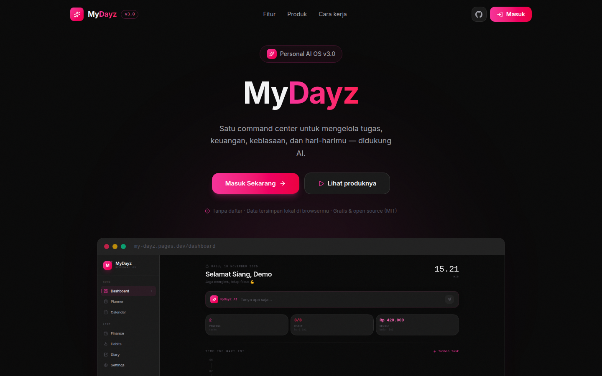
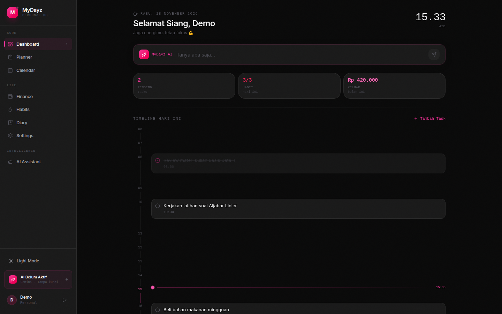
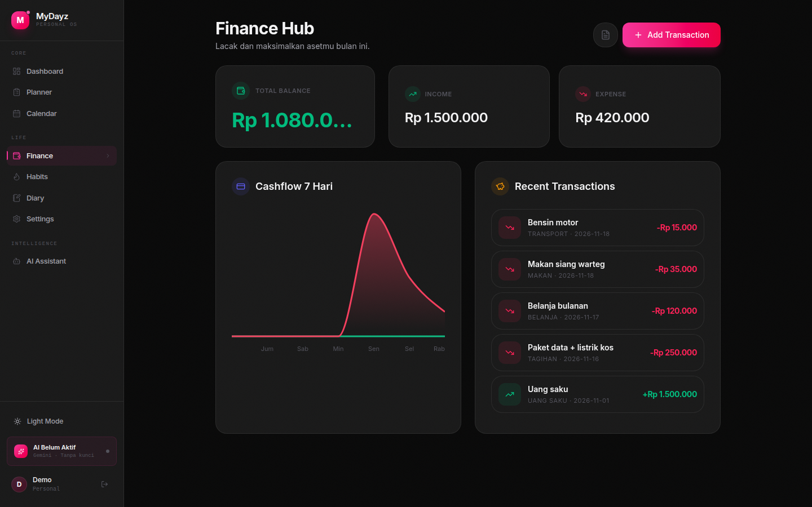
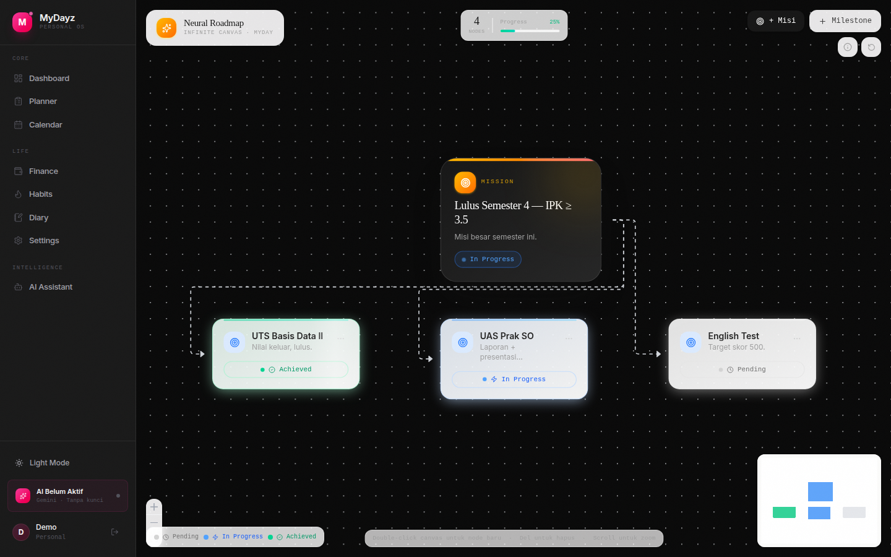
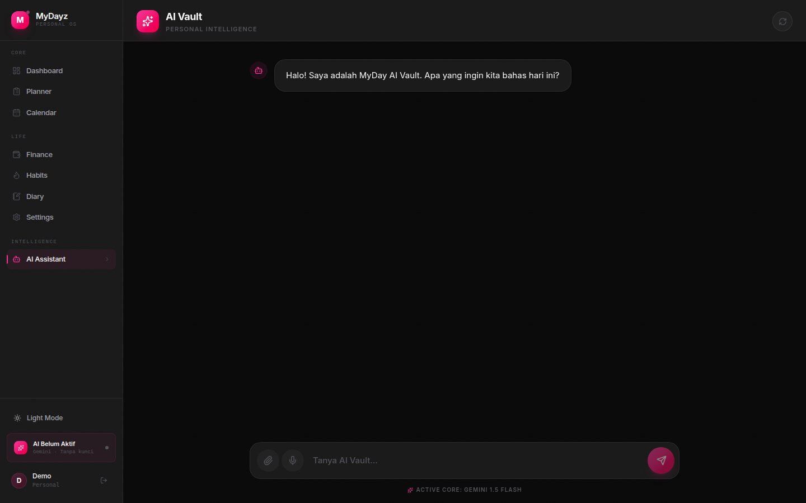

# MyDayz — Personal AI OS

> Satu command center untuk mengelola tugas, keuangan, kebiasaan, dan hari-harimu — didukung AI.

[](https://github.com/dezzorigin/my-dayz/actions/workflows/ci.yml)
[](LICENSE)

**Live:** https://my-dayz.pages.dev
**Repo:** https://github.com/dezzorigin/my-dayz



MyDayz adalah Personal AI OS: dashboard, planner, kalender, keuangan,
habits, diary, neural map (roadmap), dan AI Assistant berbasis Gemini —
dalam satu aplikasi Next.js yang **local-first**: semua data tinggal di
`localStorage` browser, tanpa akun, tanpa server yang menyimpan datamu.

## Coba langsung (tanpa daftar)

1. Buka https://my-dayz.pages.dev
2. Klik **Masuk Sekarang** → **Masuk sebagai demo**
3. Dashboard langsung terisi data contoh (task, habit, keuangan, roadmap).

Tidak ada email verifikasi, tidak ada password. Data contoh hanya
terisi bila semua masih kosong — tidak pernah menimpa datamu.
Hapus semua data dari Pengaturan → "Hapus semua data".

## Fitur

| Modul | Isi |
|---|---|
| **Dashboard** | Sapaan harian + jam live, AI command bar, statistik, timeline vertikal 06:00–23:00 |
| **Planner** | Task + goals (mingguan/bulanan/semestral) dengan progres |
| **Kalender** | Grid bulanan, mode Personal/Akademik/Financial/Salat, event & deadline |
| **Finance** | Saldo, pemasukan/pengeluaran IDR, grafik cashflow 7 hari, transaksi berkategori |
| **Habits** | Streak, riwayat 7 hari, completion rate 30 hari |
| **Daily Diary** | Jurnal harian + mood 1–5 + tag |
| **Neural Map** | Roadmap interaktif (xyflow): misi + milestone, drag, zoom, minimap |
| **AI Assistant** | Chat Gemini 1.5 Flash (teks + gambar + suara), auto-tambah task dari perintah |

## Tampilan asli


*Dashboard (mode demo): sapaan, AI bar, statistik, timeline.*


*Finance Hub: saldo, cashflow 7 hari, transaksi terbaru.*


*Neural Map: 1 misi + 3 milestone (data contoh).*


*AI Vault: chat Gemini.*

Semua screenshot di [`docs/screenshots/`](docs/screenshots/) (13 gambar,
tangkapan layar asli dari play-test headless).

## Video demo

https://github.com/dezzorigin/my-dayz/blob/main/docs/demo/demo.mp4
— 15 detik, 6 adegan (landing → dashboard → habits → finance →
roadmap → AI), dibuat dari screenshot asli di atas
(`scripts/make-video.mjs`).

> Video demo di GitHub tidak bisa di-preview inline dari README;
> unduh `docs/demo/demo.mp4` untuk menontonnya.

## Cara jalan

```bash
# Install dependencies
npm ci

# Development server
npm run dev        # http://localhost:3000

# Production build (static export + Worker)
npm run build

# Sajikan hasil build + Worker secara lokal
npm run serve      # http://127.0.0.1:8332

# Typecheck & lint (keduanya hijau di CI)
npm run typecheck
npm run lint
```

### Environment (opsional)

```bash
cp .env.example .env.local
```

| Variabel | Wajib | Keterangan |
|---|---|---|
| `GEMINI_API_KEY` | Tidak | Tanpa kunci, AI menjawab 503 `AI_KEY_REQUIRED` yang jelas; semua fitur lain tetap jalan. Di Pages, pasang sebagai environment variable. |
| `NEXT_PUBLIC_SUPABASE_URL` / `NEXT_PUBLIC_SUPABASE_ANON_KEY` | Tidak | Sinkronisasi cloud — disiapkan, **belum aktif**. Tanpa keduanya, MyDayz berjalan local-first. |

## Arsitektur

```
Browser (React 19 + Zustand + localStorage)
  │ HTTPS
  ▼
Cloudflare Pages — out/ (13 halaman statis)
  │ /api/* → Worker
  ▼
Pages Worker (worker/_worker.js) — GET /api/status, POST /api/chat
  │ bila GEMINI_API_KEY ada
  ▼
Gemini API (gemini-1.5-flash) — opsional
```

Detail: [`docs/ARCHITECTURE.md`](docs/ARCHITECTURE.md) +
[`docs/DIAGRAMS.html`](docs/DIAGRAMS.html) (diagram SVG).
Kontrak API: [`docs/API.md`](docs/API.md).
Skema data: [`docs/SCHEMA.md`](docs/SCHEMA.md).
Keamanan: [`docs/SECURITY.md`](docs/SECURITY.md).
Deployment: [`docs/DEPLOYMENT.md`](docs/DEPLOYMENT.md).

## Struktur proyek

```
src/
  app/            # 13 rute (landing, login, dashboard, planner,
                  # calendar, finance, habits, diary, roadmap, ai, settings)
  components/     # layout (AppShell, Sidebar, AuthGate, ...),
                  # roadmap (xyflow nodes), ui
  hooks/          # useIsMounted
  lib/            # constants, supabase (lazy), demo (seed), utils
  store/          # 11 store Zustand (satu per domain)
worker/
  _worker.js      # Pages Worker: /api/status + /api/chat + fallback aset
scripts/
  copy-worker.mjs     # Worker → out/_worker.js saat build
  serve-worker.mjs    # Serve lokal out/ + Worker (:8332)
  screenshot.mjs      # Play-test headless + screenshot asli
  make-video.mjs      # Video demo dari screenshot
  advisory-sweep.py   # Gate advisory produksi
docs/
  *.md            # PRD, arsitektur, komponen, skema, keamanan, deploy, demo, desain, API
  DIAGRAMS.html   # Diagram SVG
  screenshots/    # 13 screenshot asli
  demo/demo.mp4   # Video demo 15 detik
```

## Status AI — jujur, bukan klaim

Pill di sidebar membaca `GET /api/status`: **"AI Active / Gemini ·
Connected"** hanya bila kunci benar-benar terpasang; bila tidak,
**"AI Belum Aktif / Gemini · Tanpa kunci"**. Chat tanpa kunci menjawab
`503 AI_KEY_REQUIRED` — bukan jawaban palsu.

## Tech stack

Next.js 16 (App Router, static export) · React 19 · Tailwind CSS 4 ·
Zustand 5 · xyflow 12 · Recharts 3 · Framer Motion 12 · Gemini 1.5 Flash
(via Worker) · Supabase-js (disimpan untuk sinkronisasi berikutnya)

## Lisensi

MIT — lihat [LICENSE](./LICENSE).

---
_Dikembangkan oleh **dezzorigin** (Nabil Aulia Dika)._
